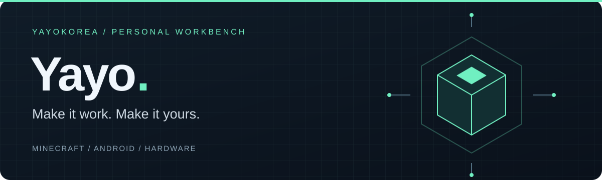

### 안녕하세요, Yayo입니다 👋

필요한 도구를 직접 만들고, 궁금한 기술은 끝까지 파고듭니다.
마인크래프트 런처와 서버부터 Android 앱, 하드웨어까지 — 아이디어를 실제로 작동하는 것으로 만드는 걸 좋아합니다.

**Minecraft & Web** · **Android & Networking** · **Embedded & Hardware**

---

### 만드는 것들

| 프로젝트 | 이런 걸 만들어요 | 기술 |
| :--- | :--- | :--- |
| **[YayoLauncher](https://github.com/yayokorea/YayoLauncher)** | 모드 마인크래프트를 위한 데스크톱 런처 | TypeScript · Electron · Svelte |
| **[WebGUI · Paper](https://github.com/yayokorea/webgui-paper)** | Minecraft 안에 웹 GUI와 HUD를 연결하는 WebGUI 포크 · Paper 지원 확장 | Java · Chromium |
| **[SSH Tunneling Android](https://github.com/yayokorea/ssh-tunneling-android)** | 위젯으로 연결하는 SSH 터널과 ADB 무선 디버깅 터널 | Kotlin · Jetpack Compose |
| **[SOOP All Record](https://github.com/yayokorea/soop-all-record)** | SOOP 라이브 원본 스트림을 저장하는 유저스크립트 | JavaScript |

### 하드웨어도 만져요

- **[Superstrike Zephyr](https://github.com/yayokorea/superstrike-zephyr)** — 홀센서 클릭 감지, 래피드 트리거, BLE 설정을 위한 펌웨어와 웹 드라이버
- **[Quest UVC Diagnostic](https://github.com/yayokorea/quest-uvc-diagnostic)** — Quest 2의 USB 카메라 연결과 영상 수신을 검증하는 진단 앱

---

  작은 불편함에서 시작해서, 직접 쓰는 도구로.

