  

  <b>I build the things I need.</b> 
  From Minecraft servers and launchers to Android apps and hand-soldered hardware.

### ⛏️ Advancements

  
  
  
  
  
  

### 🧰 Inventory

  
  
  
  
  
  
  
  
  
  
  

### 📜 Statistics

  
  

  

  <picture>
    <source media="(prefers-color-scheme: dark)" srcset="https://raw.githubusercontent.com/yayokorea/yayokorea/output/github-snake-dark.svg">
    
  </picture>

